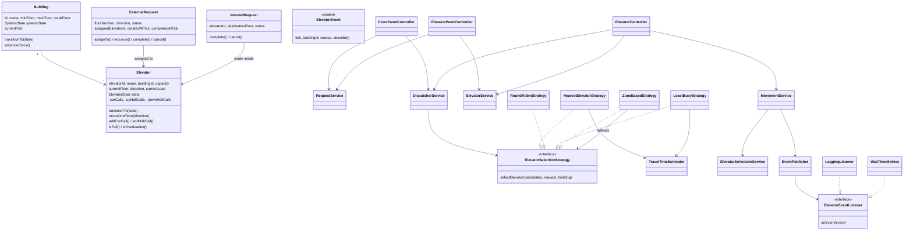

# Elevator System — Low Level Design (Java)

A low-level design of a multi-building, multi-elevator group controller, implemented in plain Java 17 with no external dependencies.
It models hall calls and car calls, dispatches each hall call to the car with the **lowest estimated time of arrival**, moves every car with the
**LOOK** algorithm on a deterministic clock, and handles the operational side of a real installation: load sensing, maintenance,
fire recall, graceful shutdown, metrics, and concurrent access from many threads.

**Level:** senior engineer (SDE-3). The core (entities, one strategy, basic SCAN) is an SDE-1 question, and adding direction-aware LOOK
and pluggable dispatch makes it SDE-2. The senior version is judged on the parts below that change system behaviour under real
conditions: correct cost modelling, enforced state machines, failure and safety modes, concurrency with a clear isolation boundary,
and observability.

## Problem Statement

> **Design and implement the group controller for the elevators of one or more buildings.**
>
> Each building has a fixed range of floors (it may include basements), `N` cars with a passenger capacity, and a designated
> **recall floor** (usually the lobby). People on a floor press **UP** or **DOWN**; inside a car they press a **destination floor**.
> Each car has a **load sensor**. Operators can take cars out of service, trigger a **fire recall**, and shut a building down.
>
> The controller decides **which car answers each hall call** and **in what order each car visits its stops**, minimising passenger
> waiting time while staying **safe** (never moving with the doors open, never moving overloaded, recalling on fire) and
> **correct under concurrency**: buttons are pressed from many threads while the clock moves the cars, and one building's
> load must not slow down another.
>
> The design must be layered (controller → service → repository → entity), extensible through design patterns,
> observable, and demonstrated by a runnable simulation and an automated test suite.

### Functional requirements

1. **Buildings**
   - Create a building with a name, lowest and highest floor, recall floor, number of cars and per-car capacity.
   - Validation: `minFloor < maxFloor`, recall floor within range, at least one car, positive capacity.
   - Cars are named `E1 … En` and start idle at the lowest floor.
   - Any number of buildings run side by side, each with its own clock and lifecycle.
2. **Hall calls (external requests)**
   - The floor must exist; UP is not allowed on the top floor and DOWN is not allowed on the bottom floor.
   - Pressing a lit button (same floor and direction, still active) **returns the existing request**, even when many people press it at the same instant.
   - Each hall call is assigned to exactly one car. If no car is available it stays `QUEUED` and is retried, oldest first, on every tick.
3. **Car calls (internal requests)**
   - The floor must exist and the car must be in service. The car stops there whenever it reaches it.
   - Pressing for the current floor while the doors are open **keeps the doors open**. It must not close and reopen them.
4. **Dispatch: choosing the car**
   - Pick the car with the lowest **estimated time of arrival (ETA)** in ticks, following the route LOOK will really take:
     - a car heading towards the caller in the caller's direction pays only the floors between them, **plus 2 ticks for every stop on the way**;
     - a car moving away pays for finishing its sweep **to its farthest pending stop** (LOOK), not to the end of the building (SCAN), and coming back;
     - a car with its doors open pays one extra tick to close them.
   - Break ties by fewest pending stops, then by name.
   - Cars that are in maintenance or **full** are never chosen.
   - The rule is **pluggable at runtime** (Nearest/ETA, Round Robin, Least Busy, Zone Based). Strategies are shared by all buildings, so they must be thread-safe.
5. **Scheduling: order of stops (LOOK)**
   - A car keeps travelling in its direction while it has stops ahead, then reverses, or goes idle when it has nothing to do.
   - Car calls are served whenever the car passes that floor.
   - A hall call is served only when the car is travelling in the **requested direction**, or at the floor where it turns around.
     *Example: a DOWN call on floor 6 is not answered by a car passing floor 6 on its way up to floor 9.*
   - An idle car with stops on both sides goes **up first**.
6. **Load sensing**
   - The load sensor reports the number of passengers while the car is stopped. Readings while moving are rejected.
   - **Overload** (load > capacity): the doors stay open and the car does not move until the load drops.
   - **Full** (load ≥ capacity): the car stops answering hall calls (*full-load bypass*). Its assigned hall calls go back to the queue and are
     re-dispatched immediately, while its passengers' car calls are still served.
7. **Maintenance**
   - Taking a car out of service cancels its car calls and re-queues and re-dispatches its hall calls.
   - Returning a car to service makes it available again. If the building is in an emergency, the car joins the recall instead.
8. **Fire recall (emergency)**
   - Every active hall call and car call in the building is **cancelled**, and new requests are rejected.
   - Every in-service car drops its stops and travels **non-stop** to the recall floor, reversing immediately if it was heading away. It opens its doors there and parks.
   - Clearing the emergency returns the building to normal service.
9. **Building lifecycle**: `STOPPED → RUNNING → STOPPING → STOPPED`, and `RUNNING / STOPPING → EMERGENCY → RUNNING`.
   - Requests are accepted only while `RUNNING`.
   - `STOPPING` is a graceful shutdown. New requests are rejected, but outstanding ones are finished, and then the building becomes `STOPPED` automatically.
   - Illegal transitions (for example a fire recall in a `STOPPED` building) are rejected.
10. **State machines are enforced, not assumed**
    - Car: `IDLE`, `MOVING`, `DOORS_OPEN`, `DOORS_CLOSING`, `MAINTENANCE`, with an explicit table of legal transitions. A car can never move with its doors open.
    - Hall call: `QUEUED → ASSIGNED → COMPLETED`, `ASSIGNED → QUEUED` (requeue), and any active call can become `CANCELLED`.
    - Car call: `PENDING → COMPLETED / CANCELLED`.
    - Finished requests can never be reopened.
11. **Simulation clock**: time advances in discrete ticks. On each tick a car does exactly one thing: open its doors, hold them, close them, move one floor, or stay idle.
    The clock is driven either step by step (tests, demo) or in real time on its own thread (`RealTimeClock`).
12. **Observability**
    - Everything that happens is published as a typed event (car moved, stopped, doors held, hall call picked up, calls handed back, service changed, building state changed).
    - Logging and metrics are subscribers, and a failing subscriber must not stop the clock.
    - Per building, track the **hall-call wait time**: number served, average and worst wait in ticks, from button press to doors opening.

### Non-functional requirements

- Plain **Java 17**, no external libraries or frameworks.
- **Layered architecture**: controllers expose the API, services hold business logic, repositories hide storage, and entities hold state *and protect their own invariants*.
- **Encapsulation:** entities expose behaviour, not mutable internals. The public API returns **immutable snapshots** (records), never live domain objects.
- **Concurrency:** all public operations are thread-safe. Operations on one building are linearizable, and different buildings never block each other.
- **Storage** behind repository interfaces with in-memory implementations. Lookups that the hot path depends on, such as the duplicate check and queued calls, use indexes rather than full scans, and each maps to a database index.
- **Manual dependency injection** with a single composition root (`ElevatorSystem`).
- **Deterministic** simulation, so behaviour is reproducible and testable.
- Clear errors: `IllegalArgumentException` for bad input, `IllegalStateException` for an operation that is invalid in the current state.

### Expected deliverables

- The entity model with its state machines, the repositories, services, strategies (with a factory), controllers, events and read models described under [Architecture](#architecture).
- A `Main` demo that runs these scenarios:
  1. A ride from floor 5 to floor 9.
  2. An overloaded car holding its doors open, and a full car handing its hall call to another car.
  3. Simultaneous calls spread across the cars with the lowest ETA.
  4. Maintenance hand-over.
  5. The same calls under every strategy, switched at runtime.
  6. A fire recall.
  7. The wait-time metrics.
  8. A graceful shutdown.
- A test suite (29 tests) covering scheduling, the ETA model (LOOK vs SCAN, stop penalties), every strategy, validation, lifecycle and state-machine enforcement,
  snapshot immutability, maintenance, full-load bypass, overload, graceful stop, fire recall, metrics, listener isolation, duplicate presses from 16 threads,
  400 presses from 8 threads while the clock runs, building isolation under a stalled lock, and the real-time clock.

### Assumptions

- Moving one floor, opening the doors and closing the doors each take one tick, so a stop costs two ticks.
- Load is reported by the car's sensor as a passenger count. Passengers are not simulated individually.
- The clock is per building, and every timestamp in a building is measured in that building's ticks.
- Strategies are global (one per system) and must be thread-safe. Per-building strategy is a straightforward extension.

## Architecture

The code is layered like a typical backend service: **controller → service → strategy / scheduler → repository → entity**, with events flowing out to subscribers.

```
src/
├── Main.java                         demo: eight scenarios, every car movement printed
└── elevatorSystem/
    ├── ElevatorSystem.java           composition root (wires everything, owns the event bus)
    ├── entity/                       Building, Elevator, ExternalRequest, InternalRequest + enums with transition tables
    ├── dto/                          immutable read models: BuildingView, ElevatorView, HallCallView, CarCallView
    ├── event/                        ElevatorEvent (sealed), EventPublisher, LoggingListener, WaitTimeMetrics
    ├── repository/                   repository interfaces
    │   └── impl/                     indexed in-memory implementations (ConcurrentHashMap)
    ├── service/
    │   ├── BuildingService           creates buildings and their cars, lifecycle transitions
    │   ├── ElevatorService           lookup, maintenance, load sensing, fire recall
    │   ├── RequestService            validates/creates requests, moves them through their lifecycle
    │   ├── DispatcherService         assigns hall calls using the current strategy
    │   ├── ElevatorSchedulerService  LOOK: where to stop, which way to go next
    │   └── MovementService           advances one car by one tick, publishes what happened
    ├── strategy/
    │   ├── ElevatorSelectionStrategy
    │   ├── TravelTimeEstimator       LOOK-accurate ETA in ticks
    │   ├── NearestElevatorStrategy   lowest ETA (default)
    │   ├── RoundRobinStrategy        take turns: E1, E2, E3, E1, ...
    │   ├── LeastBusyStrategy         fewest pending stops, ETA breaks ties
    │   ├── ZoneBasedStrategy         each car owns a band of floors, with a fallback strategy
    │   ├── StrategyType              enum: NEAREST, ROUND_ROBIN, LEAST_BUSY, ZONE_BASED
    │   └── SelectionStrategyFactory  builds a strategy from a StrategyType or a config string
    └── controller/
        ├── ElevatorController        operator API: lifecycle, maintenance, recall, strategy, clock, queries
        ├── FloorPanelController      hall UP/DOWN buttons
        ├── ElevatorPanelController   cabin floor buttons and load sensor
        ├── BuildingLocks             one fair lock per building
        └── RealTimeClock             drives a building's clock on a scheduled thread
test/
└── elevatorSystem/ElevatorSystemTest.java
```

### Class diagram



### Request flow

1. Someone on floor 5 presses **UP** → `FloorPanelController` takes **that building's** lock → `RequestService` validates and either returns
   the lit request (an indexed lookup) or stores a new `ExternalRequest` (`QUEUED`, stamped with the current tick).
2. In the same locked step, `DispatcherService` asks the strategy for the car with the lowest ETA, the request becomes `ASSIGNED`, and floor 5
   is added to that car's UP hall calls. The caller receives a `HallCallView` snapshot.
3. Each `tick`, the building's clock advances, queued calls are retried, and `MovementService` moves every car one step,
   asking `ElevatorSchedulerService` whether to stop here and which way to go next.
4. When the car stops at floor 5, its doors open, the request is `COMPLETED`, and a `HallCallCompleted` event carries the wait time
   to `WaitTimeMetrics` and to the log.
5. The passenger presses **9** → `ElevatorPanelController` creates an `InternalRequest` and adds 9 to the car's car calls.

### Design patterns

| Pattern | Where |
| --- | --- |
| Strategy | `ElevatorSelectionStrategy` with four implementations, swapped at runtime |
| Factory | `SelectionStrategyFactory.create(StrategyType \| String)`, the only place that constructs strategies |
| Decorator-style fallback | `ZoneBasedStrategy` wraps another strategy for when its zone's car is unavailable |
| Observer | `EventPublisher` → `ElevatorEventListener` (logging, metrics, or any display or audit subscriber) |
| State machine (table-driven) | `ElevatorState.canTransitionTo`, `SystemState.canTransitionTo`. `Elevator` and `Building` reject illegal edges |
| Rich domain model / aggregate | `Elevator` owns its stop sets and state, and `ExternalRequest`/`InternalRequest` own their lifecycle |
| Repository | `repository/*` interfaces, with indexed in-memory implementations replaceable by a database |
| DTO / read model | `dto/*` immutable records returned by every controller |
| Dependency injection (manual) | constructor injection everywhere, wired in `ElevatorSystem` |
| Facade | the three controllers expose a small API over the services |

### State machines

**Car** (`ElevatorState`). Every tick moves the car along at most one edge, and anything else throws `IllegalStateException`.

| From | Allowed next |
| --- | --- |
| `IDLE` | `MOVING`, `DOORS_OPEN`, `MAINTENANCE` |
| `MOVING` | `DOORS_OPEN`, `IDLE`, `MAINTENANCE` |
| `DOORS_OPEN` | `DOORS_CLOSING`, `MAINTENANCE` |
| `DOORS_CLOSING` | `MOVING`, `IDLE`, `DOORS_OPEN` (reopen when overloaded), `MAINTENANCE` |
| `MAINTENANCE` | `IDLE` |

`DOORS_OPEN → MOVING` is deliberately missing, so a car cannot move with its doors open.

**Building** (`SystemState`): `STOPPED → RUNNING`, `RUNNING → STOPPING | EMERGENCY`, `STOPPING → STOPPED | EMERGENCY`, `EMERGENCY → RUNNING`.

### Dispatch: the ETA model (`TravelTimeEstimator`)

Let `c` be the car's floor, `t` the caller's floor, and `DOOR = 2` ticks per stop.

| Car situation | Estimated ticks |
| --- | --- |
| Idle | `\|c − t\|` |
| Heading to the caller in the caller's direction | `\|c − t\|` + `DOOR` × stops strictly between |
| Moving up, caller wants DOWN | up to `turn = max(farthest stop, t)`, then down to `t`, + `DOOR` × pending stops |
| Moving up, caller wants UP but is below | up to the farthest stop, down to `min(lowest stop, t)`, back up to `t`, + `DOOR` × pending stops |
| Moving down | the mirror image of the two rows above |
| Doors currently open | + 1 to close them |

**Why LOOK and not SCAN:** the cars turn at their last stop. A SCAN estimate (turning at the top or bottom floor) can be wrong by tens of floors
and send an idle far-away car instead of one about to turn back. The test *"ETA turns at the last stop (LOOK), not the end of the building (SCAN)"*
pins this: on floors 0–20, the LOOK estimate is 7 ticks while SCAN would give 37.

| Strategy | Picks | Good for | Trade-off |
| --- | --- | --- | --- |
| `NearestElevatorStrategy` (default) | lowest ETA | shortest wait | busy cars near the caller keep getting work |
| `RoundRobinStrategy` | next available car in turn | even wear | ignores position |
| `LeastBusyStrategy` | fewest pending stops, ETA breaks ties | rush hour | may skip a slightly busier but closer car |
| `ZoneBasedStrategy` | the car owning the caller's floor band, else a fallback | tall buildings | a zone can be busy while others idle |

Adding a strategy takes a class, an enum constant and one `case` in the factory. The test *"factory builds every strategy type"* fails if a constant is forgotten.

### Concurrency model

- **Isolation boundary = building.** Cars, requests and the clock all belong to exactly one building, so `BuildingLocks` keeps **one fair
  `ReentrantLock` per building**. Every controller method takes only its building's lock. Buildings run fully in parallel, and the test
  *"a busy building does not block another building"* stalls one building's tick inside a listener while another building serves a call.
- **Press = create + dispatch, atomically.** When 16 threads press floor 6 UP at once, one request is created.
- **Ticks and presses on one building never interleave**, so the cars' `TreeSet`s and request statuses need no further synchronisation.
- **Finding the lock without the lock:** an elevator's and a request's `buildingId` are `final`, and the repositories are `ConcurrentHashMap`s,
  so the right lock can be found safely before acquiring it.
- **No leaked state:** controllers return immutable records, so callers on other threads can never read a half-updated car.
- **`runUntilIdle` locks per tick**, and the lock is **fair**, so neither presses nor the clock can starve each other.
- **Strategy swap** is a `volatile` write that each dispatch reads once. `RoundRobinStrategy` keeps per-building `AtomicInteger` counters.
- **Events are delivered synchronously under the building lock.** That keeps ordering per building trivially correct, but listeners must be fast,
  and a listener that throws is reported and skipped.

**Next steps at larger scale:**
- A single-threaded event loop per building fed by a `BlockingQueue` of commands (actor style, no locks in services).
- Asynchronous event delivery through a queue, so slow subscribers cannot extend the lock hold time.
- Sharding buildings across processes, which the per-building isolation already allows.

### Fire recall

`emergencyRecall(building)` runs as one locked step:
1. The building moves to `EMERGENCY`, so new requests are rejected.
2. Every active hall call and car call is cancelled.
3. Every in-service car drops its stops and gets a single stop at the recall floor.

LOOK then takes over. A car moving away reverses on the next tick, passes every other floor without stopping, opens its doors at the recall floor and parks.
A car leaving maintenance during the emergency joins the recall. `clearEmergency` returns the building to `RUNNING`.

### Load sensing

| Reading | Effect |
| --- | --- |
| load ≤ capacity − 1 | normal service |
| load = capacity (**full**) | assigned hall calls are re-queued and re-dispatched immediately, and no new hall calls are assigned. Car calls are still served |
| load > capacity (**overloaded**) | also full. The doors stay open (or reopen) every tick until the load drops |

## Code Reference

What every folder and file contains, and what each method does. A button press travels through the layers in this order:
**controller → service → strategy / scheduler → repository → entity**, and events flow out through `EventPublisher`.

### `src/Main.java`: demo

Builds "Tech Park" (floors 0–10, 3 cars, capacity 8) and prints every event.

| Method | Description |
| --- | --- |
| `main(args)` | Runs the eight scenarios listed under [Expected deliverables](#expected-deliverables). |
| `waitForPickup(request)` | Ticks until the hall call is `COMPLETED`, then returns a snapshot of the car that served it. Throws if it is not served within 50 ticks. |
| `nameOf(elevatorId)` | Turns a car ID into its name, or `"(queued)"` if none is assigned. |
| `section(title)` | Prints a `=== title ===` heading. |

### `ElevatorSystem.java`: composition root

| Method | Description |
| --- | --- |
| `ElevatorSystem(log)` / `(strategyType, log)` / `(strategy, log)` | Builds the system and subscribes a `LoggingListener` writing to `log`. |
| `ElevatorSystem(strategy)` | Does the wiring: repositories, services, `WaitTimeMetrics`, `BuildingLocks`, controllers. No logging. |
| `subscribe(listener)` | Adds an event subscriber for every building. |
| `getElevatorController()` / `getFloorPanelController()` / `getElevatorPanelController()` | The public API. |

### `entity/`: domain objects that protect their own invariants

| Class | Responsibility |
| --- | --- |
| `Building` | Immutable configuration (`name`, floors, `recallFloor`, `elevatorCount`), plus `systemState` and the simulation clock. `transitionTo(state)` enforces the lifecycle, and `advanceClock()` returns the new tick. |
| `Elevator` | One car. Its stop sets are private: `addCarCall`, `addHallCall`, `removeCarCall`, `removeHallCall`, `clearStops`, `clearHallCalls`. Queries: `hasStopsAbove/Below`, `highestStop`, `lowestStop`, `stopsBetween(from, to, direction)`, `getPendingStopCount`. State: `transitionTo` (validated) and `moveOneFloor` (only legal with the doors closed). Load: `updateLoad`, `isFull`, `isOverloaded`, `isAvailableForDispatch`. |
| `ExternalRequest` | A hall call with `assignTo`, `requeue`, `complete(tick)` and `cancel`. Each one checks the current status. `waitTicks()` is completion tick minus creation tick, and `sequence` orders calls made in the same tick. |
| `InternalRequest` | A car call with `complete(tick)` and `cancel`, both only from `PENDING`. |
| `ElevatorState` | `IDLE`, `MOVING`, `DOORS_OPEN`, `DOORS_CLOSING`, `MAINTENANCE`, plus `canTransitionTo`. |
| `SystemState` | `STOPPED`, `RUNNING`, `STOPPING`, `EMERGENCY`, plus `canTransitionTo` and `acceptsRequests`. |
| `RequestStatus` | `QUEUED`, `ASSIGNED`, `PENDING`, `COMPLETED`, `CANCELLED`, plus `isTerminal`. |
| `Direction` | `UP`, `DOWN`, `IDLE`, plus `opposite`. |

### `dto/`: immutable read models

`BuildingView`, `ElevatorView` (stop lists are unmodifiable copies), `HallCallView` and `CarCallView`. Each is a `record` with a static `of(entity)`.
They are returned by every controller, so no caller ever holds a live entity.

### `event/`: observability

| Class | Description |
| --- | --- |
| `ElevatorEvent` | Sealed interface: `Moved`, `Stopped`, `DoorsHeld`, `DoorsClosing`, `Idle`, `HallCallCompleted`, `HallCallsReleased`, `ServiceChanged`, `SystemStateChanged`. Each carries `tick`, `buildingId` and `source` (car or building name), and `describe()` gives the log text. |
| `ElevatorEventListener` | `onEvent(event)`. Called synchronously under the building lock. |
| `EventPublisher` | `subscribe`, `unsubscribe`, `publish`. A throwing listener is reported to stderr and skipped. |
| `LoggingListener` | Formats lines such as `t=005 E1: moving UP 4 -> 5`. |
| `WaitTimeMetrics` | Per-building `Stats(served, totalWaitTicks, maxWaitTicks)` with `averageWaitTicks()`, updated atomically with `ConcurrentHashMap.merge`. |

### `repository/` and `repository/impl/`: storage

Services call `save` after every status change, so a database implementation sees every transition.

| Interface | Methods | In-memory index (SQL equivalent) |
| --- | --- | --- |
| `BuildingRepository` | `save`, `findById`, `findAll` | by id |
| `ElevatorRepository` | `save`, `findById`, `findByBuilding` (sorted by name) | by id, by building |
| `ExternalRequestRepository` | `save`, `findById`, `findActive(building, floor, direction)`, `findActiveByBuilding`, `findQueued` (oldest first), `findAssignedTo(building, elevator)` | active calls by building, and lit button → id (a unique partial index on active calls) |
| `InternalRequestRepository` | `save`, `findById`, `findPendingByElevator(building, elevator)`, `findPendingByBuilding` | pending calls by building |

Finished requests leave the active indexes, so hot-path lookups scale with the calls in flight, not with history.

### `service/`: business logic

| Service | Methods |
| --- | --- |
| `BuildingService` | `createBuilding(...)` stores the cars before the building, so no thread sees a building without its cars. `getBuilding`, and `transition(building, state)`, which validates and publishes `SystemStateChanged`. |
| `ElevatorService` | `createElevator`, `getElevator`, `findByBuilding`, `findAvailableForDispatch`. `startMaintenance` requeues hall calls, cancels car calls and clears stops. `endMaintenance` joins the recall during an emergency. `updateLoad` applies the full-load bypass and rejects readings while moving. `recall(elevator, building)` gives a non-stop trip to the recall floor. |
| `RequestService` | `createHallCall` (validation plus duplicate merge), `createCarCall`, `assign`, `completeAtCurrentFloor` (returns completed hall calls for metrics), `requeueHallCalls`, `cancelCarCalls`, `cancelAll`, `findQueued`, `hasOutstandingRequests`, `getHallCall`, `getCarCall`. |
| `DispatcherService` | `dispatch(building, request)` picks from available cars with the current strategy. `dispatchQueued(building)` retries oldest first. `setSelectionStrategy` is a volatile write. |
| `ElevatorSchedulerService` | Stateless LOOK. `shouldStopAtCurrentFloor`, `serveCurrentFloor` (returns the hall directions served), `nextDirection`. |
| `MovementService` | `step(building, elevator)`: an overloaded car holds or reopens its doors. With doors open, it serves a new stop here or closes. Otherwise it stops, moves one floor or goes idle. Every outcome is published as an event. |

### `strategy/`: which car answers a hall call

| Class | Description |
| --- | --- |
| `ElevatorSelectionStrategy` | `selectElevator(candidates, request, building)`. Candidates are already filtered to in-service, non-full cars. |
| `TravelTimeEstimator` | `estimate(elevator, targetFloor, wantedDirection)`, the ETA model above. |
| `NearestElevatorStrategy` | Minimum ETA, then fewest stops, then name. |
| `RoundRobinStrategy` | Per-building `AtomicInteger` cursor over cars sorted by name. |
| `LeastBusyStrategy` | Fewest stops, then ETA, then name. |
| `ZoneBasedStrategy` | `zoneOf(floor, building)` splits floors evenly across `E1..En`. Falls back to another strategy (Nearest by default). |
| `StrategyType`, `SelectionStrategyFactory` | Enum plus factory. `create(String)` accepts config values such as `" zone_based "`. |

### `controller/`: the public API (thread-safe)

| Class | Methods |
| --- | --- |
| `FloorPanelController` | `pressButton(building, floor, direction)` → `HallCallView`. Create and dispatch run as one atomic step. |
| `ElevatorPanelController` | `pressFloorButton(elevator, floor)` → `CarCallView`. `reportLoad(elevator, passengers)` → `ElevatorView`, and re-dispatches any hall calls handed back. |
| `ElevatorController` | Lifecycle: `createBuilding`, `start`, `stop`, `emergencyRecall`, `clearEmergency`. Cars: `startMaintenance`, `endMaintenance`, `setSelectionStrategy`. Clock: `tick`, `runUntilIdle`, `isIdle`. Queries: `getBuilding`, `getElevators`, `getElevator`, `getHallCall`, `getCarCall`, `getWaitTimeStats`, `statusReport`. |
| `BuildingLocks` | `call(buildingId, supplier)` and `run(buildingId, runnable)` on a fair, reentrant lock per building. |
| `RealTimeClock` | `start(controller, building, period)` ticks on a daemon thread. `close()` stops it and waits for the in-flight tick. A failing tick is reported and the clock continues. |

### `test/elevatorSystem/ElevatorSystemTest.java`

A dependency-free runner (`main`) with 29 tests grouped as scheduling, dispatching, requests and validation, availability, building lifecycle,
observability and concurrency. Helpers: `building(...)`, `elevator(building, index)`, `status(call)`, `ticks`, `runUntil(condition)`,
`stops()` (parses the log), `runConcurrently(threads, task)`, and minimal assertions.

## Running

Requires JDK 17+.

**IntelliJ IDEA:** open the folder and run `Main` (demo) or `ElevatorSystemTest` (tests).

**Command line:**

```bash
# demo
javac -d out $(find src -name "*.java")
java -cp out Main

# tests
javac -d out $(find src test -name "*.java")
java -cp out elevatorSystem.ElevatorSystemTest
```

On Windows PowerShell, replace the `$(find …)` part with `(Get-ChildItem -Recurse -Filter *.java src, test).FullName`.

### Sample output

```
=== 2. An overloaded car holds its doors open; a full car hands its hall calls to another car ===
t=015 E1: stopped at floor 9, doors opening
t=015 E1: picked up floor 9 DOWN after 1 ticks
floor 6 DOWN -> E1 (on its way down)
t=015 E1: full, handed back 1 hall call(s)
t=016 E1: doors held open at floor 9 (overloaded 9/8)
t=016 E2: moving UP 0 -> 1
floor 6 DOWN -> E2 (E1 is full)
t=017 E1: doors closing at floor 9
...
t=022 E2: stopped at floor 6, doors opening
t=022 E2: picked up floor 6 DOWN after 7 ticks

=== 6. Fire alarm: every car is recalled to the lobby and new calls are refused ===
t=069 E2: moving UP 5 -> 6
t=069 Tech Park: system emergency
Rejected: Tech Park is EMERGENCY; new requests are not accepted
t=070 E2: moving DOWN 6 -> 5
...
```

## Discussion points and extensions

- **Re-optimising assignments:** today a hall call keeps its car once assigned (unless that car leaves service or fills up). Real group controllers re-score
  unserved calls every few ticks and move them when another car's ETA is much better, using hysteresis to avoid flip-flopping.
- **Destination dispatch:** passengers enter the destination in the lobby, and the controller groups people going to nearby floors into the same car.
- **Energy and peak modes:** park idle cars at the lobby before the morning peak, or prefer cars that are already moving.
- **Per-building strategy** and per-car speeds, with door times in milliseconds instead of ticks.
- **Persistence and recovery:** replay the event stream to rebuild state after a crash, since the events already describe every transition.
- **Async event delivery** and a lock-free, actor-style building loop for very high press rates.
