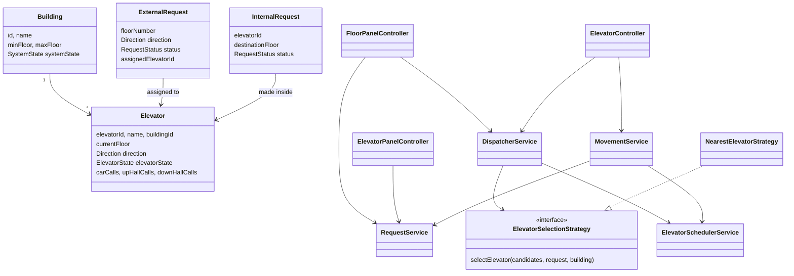

# Elevator System — Low Level Design (Java)

A low-level design of a multi-elevator controller for a building, implemented in plain Java 17 with no external dependencies.
It models hall calls (UP/DOWN buttons on each floor) and car calls (floor buttons inside the cabin), dispatches each hall call to the best elevator, and moves every elevator with the **LOOK** scheduling algorithm on a tick-based simulation clock.

## Problem Statement

> **Design and implement the low-level design of an Elevator System for a building with multiple elevators.**
>
> A building has a fixed range of floors (it may include a basement / ground floor `0`) and `N` elevators.
> People on any floor can call an elevator by pressing an **UP** or **DOWN** button in the hallway. Once inside,
> they choose a destination by pressing a **floor button** in the cabin. The system must decide **which elevator**
> answers each hallway call and **in what order** each elevator visits its stops, so that passengers are served
> efficiently and correctly. The solution should be object-oriented, layered (controller → service → repository → entity),
> extensible through design patterns, and demonstrable with a runnable simulation and tests.

### Functional requirements

1. **Building setup**
   - Create a building with a name, a lowest floor, a highest floor, a number of elevators and a per-elevator capacity.
   - The lowest floor must be below the highest floor and there must be at least one elevator.
   - All elevators start parked and idle at the lowest floor, named `E1 … En`.
2. **Hall calls (external requests)**
   - A person on floor `f` presses **UP** or **DOWN**.
   - The floor must exist; **UP is not allowed on the top floor** and **DOWN is not allowed on the bottom floor**.
   - Pressing a button that is already lit (same floor + same direction, still active) must **not** create a duplicate. The existing request is returned.
   - Each hall call must be assigned to exactly one elevator. If no elevator is available, the call stays **queued** and is retried on every clock tick.
3. **Car calls (internal requests)**
   - A passenger inside an elevator presses a destination floor.
   - The floor must exist and the elevator must be in service.
   - The elevator must stop at that floor whenever it reaches it.
4. **Dispatching: choosing the elevator**
   - Choose the elevator that can reach the caller in the **fewest floors of travel**.
   - Prefer an elevator that is **already moving towards the caller in the caller's direction** (it picks them up "on the way").
   - An elevator moving away from the caller pays the cost of finishing its sweep and coming back.
   - Break ties by fewest pending stops, then by elevator name.
   - Elevators in maintenance, inactive, or at full load are never chosen.
   - The selection rule must be **pluggable** so other strategies (zoning, round-robin, energy-saving) can be swapped in.
5. **Scheduling: order of stops (LOOK algorithm)**
   - An elevator keeps travelling in its current direction while it has stops ahead, then reverses. If it has nothing to do, it goes idle.
   - Car calls are served whenever the elevator passes that floor.
   - A hall call is served only when the elevator is travelling in the **requested direction**, or at the floor where it turns around.
     *Example: a DOWN call on floor 6 is not answered by an elevator passing floor 6 on its way up to floor 9.*
   - An idle elevator with calls both above and below goes **up first**.
6. **Movement simulation**
   - Time advances in discrete **ticks**. On each tick an elevator does exactly one thing:
     open its doors at a stop, close its doors, move one floor, or stay idle.
   - Every movement is logged (`t=005 E1: moving UP 4 -> 5`).
7. **Request lifecycle**
   - Hall call: `QUEUED → ASSIGNED → COMPLETED`, going back to `QUEUED` if its elevator goes into maintenance.
   - Car call: `PENDING → COMPLETED`, or `CANCELLED` if its elevator goes into maintenance.
   - When an elevator stops at a floor, every request it serves there is marked `COMPLETED`.
8. **Maintenance mode**
   - An elevator can be taken out of service. Its pending car calls are cancelled, its hall calls are returned to the queue and immediately re-dispatched to another elevator.
   - An elevator can be returned to service.
9. **System start / graceful shutdown**
   - A building starts `STOPPED` and accepts requests only while `RUNNING`.
   - Stopping moves the building to `STOPPING`: new requests are rejected, but all outstanding requests are finished. Once everything is idle, the building becomes `STOPPED`.

### Non-functional requirements

- Plain **Java 17**, no external libraries or frameworks.
- **Layered architecture** like a backend service: controllers expose the API, services hold business logic, repositories hide storage, entities hold state.
- Storage behind **repository interfaces** with in-memory (`ConcurrentHashMap`) implementations, so a database can replace them later.
- **Manual dependency injection** through constructors, with a single composition root (`ElevatorSystem`).
- **Deterministic simulation** (tick-based clock) so behaviour is reproducible and testable.
- Clear validation errors (`IllegalArgumentException` for bad input, `IllegalStateException` for invalid system state).

### Expected deliverables

- Entity model: `Building`, `Elevator`, `ExternalRequest`, `InternalRequest`, plus the enums `Direction`, `ElevatorState`, `RequestStatus` and `SystemState`.
- Repositories, services, a selection strategy and controllers as described in [Architecture](#architecture).
- A `Main` demo that runs these scenarios:
  1. One person on floor 5 calls UP and travels to floor 9.
  2. Several simultaneous calls (floor 2 UP, floor 7 DOWN, floor 10 DOWN) are spread across the best-placed elevators.
  3. An elevator goes into maintenance and its hall call is handed to another elevator.
  4. Graceful shutdown, after which a new request is rejected.
- Unit tests covering dispatching, LOOK ordering, validation, duplicate merging, maintenance and shutdown.

### Assumptions

- Moving one floor, opening the doors and closing the doors each take one tick.
- Passenger load is tracked (`currentLoad` / `elevatorCapacity`) only to exclude full elevators from dispatch. Load is not simulated per stop.
- One building is driven per simulation clock. Multiple buildings can be created, each with its own elevators.

## Features

- Multiple elevators per building, with configurable floor range (e.g. basement `0` to `10`) and capacity
- **Direction-aware dispatching** — a hall call goes to the elevator that can reach the caller in the fewest floors, preferring one already travelling towards the caller in the same direction
- **LOOK scheduling** — an elevator keeps moving in its direction while it has stops ahead, then reverses. A DOWN call is not answered by an elevator passing on its way up
- Request lifecycle tracking: `QUEUED → ASSIGNED → COMPLETED` for hall calls, `PENDING → COMPLETED / CANCELLED` for car calls
- Duplicate button presses are merged into the existing request
- **Maintenance mode** — taking an elevator out of service hands its hall calls to another elevator
- **Graceful shutdown** — `RUNNING → STOPPING → STOPPED`: new requests are rejected and outstanding ones are finished first
- Input validation (non-existent floors, UP from the top floor, DOWN from the bottom floor, …)

## Architecture

The code is layered like a typical backend service: **controller → service → repository → entity**.

```
src/
├── Main.java                         demo: runs four scenarios and prints every elevator move
└── elevatorSystem/
    ├── ElevatorSystem.java           composition root (wires everything together)
    ├── Entity/                       Building, Elevator, ExternalRequest, InternalRequest + enums
    ├── Repository/                   repository interfaces
    │   └── impl/                     in-memory implementations (ConcurrentHashMap)
    ├── service/
    │   ├── BuildingService           creates buildings and their elevators, system state
    │   ├── ElevatorService           elevator lookup, state updates, maintenance
    │   ├── RequestService            validates/creates requests, completes them on arrival
    │   ├── DispatcherService         assigns hall calls to elevators (uses a strategy)
    │   ├── ElevatorSchedulerService  LOOK algorithm: where to stop, which way to go next
    │   └── MovementService           advances one elevator by one tick
    ├── strategy/
    │   ├── ElevatorSelectionStrategy
    │   └── NearestElevatorStrategy
    └── controller/
        ├── ElevatorController        start/stop, maintenance, simulation clock
        ├── FloorPanelController      hall UP/DOWN buttons
        └── ElevatorPanelController   floor buttons inside the cabin
test/
└── elevatorSystem/ElevatorSystemTest.java
```

### Class diagram



### Request flow

1. Someone on floor 5 presses **UP** → `FloorPanelController` → `RequestService` validates and stores an `ExternalRequest` (`QUEUED`).
2. `DispatcherService` asks the `ElevatorSelectionStrategy` for the best elevator, marks the request `ASSIGNED` and adds floor 5 to that elevator's `upHallCalls`.
3. Each `ElevatorController.tick()`, `MovementService` asks `ElevatorSchedulerService` whether to stop at the current floor; if not, it moves one floor in the LOOK direction.
4. On reaching floor 5, the stop is cleared, the request is marked `COMPLETED` and the doors open.
5. The passenger presses **9** → `ElevatorPanelController` creates an `InternalRequest` and adds 9 to `carCalls`.

### Design patterns

| Pattern | Where |
| --- | --- |
| Strategy | `ElevatorSelectionStrategy` — swap the dispatch rule at runtime via `DispatcherService.setSelectionStrategy` |
| Repository | `Repository/*` interfaces hide storage; the in-memory impls can be replaced with a database |
| Dependency injection (manual) | every service receives its dependencies through the constructor; `ElevatorSystem` is the composition root |
| State | `ElevatorState` / `SystemState` drive what an elevator or building may do next |
| Facade | `ElevatorController` exposes a small API over the services |

### Cost function (`NearestElevatorStrategy`)

| Elevator situation | Cost (floors to reach caller) |
| --- | --- |
| Idle | `|current − caller|` |
| Moving towards the caller in the caller's direction | `|current − caller|` |
| Moving away, caller wants the opposite direction | to the end of the sweep, then back to the caller |
| Moving away, caller wants the same direction | full sweep, back to the other end, then to the caller |

Ties go to the elevator with fewer pending stops.

## Running

Requires JDK 17+.

**IntelliJ IDEA:** open the folder and run `Main` (demo) or `ElevatorSystemTest` (tests).

**Command line:**

```bash
# demo
javac -d out $(find src -name "*.java")
java -cp out Main

# tests
javac -d out $(find src test -name "*.java")
java -cp out elevatorSystem.ElevatorSystemTest
```

On Windows PowerShell, replace the `$(find …)` part with `(Get-ChildItem -Recurse -Filter *.java src, test).FullName`.

### Sample output

```
=== 1. Someone on floor 5 wants to go up to floor 9 ===
t=001 E1: moving UP 0 -> 1
...
t=005 E1: moving UP 4 -> 5
t=006 E1: stopped at floor 5, doors opening
t=007 E1: doors closing at floor 5
t=008 E1: moving UP 5 -> 6
...
t=012 E1: stopped at floor 9, doors opening
t=013 E1: doors closing at floor 9
t=014 E1: idle at floor 9
```

## Possible extensions

- Load/weight sensing per stop (the `currentLoad` / `elevatorCapacity` fields already exclude full elevators from dispatch)
- A real-time, multi-threaded clock instead of the deterministic tick loop
- Additional strategies (e.g. zoning, round-robin, energy-saving)
- Emergency stop / fire mode
